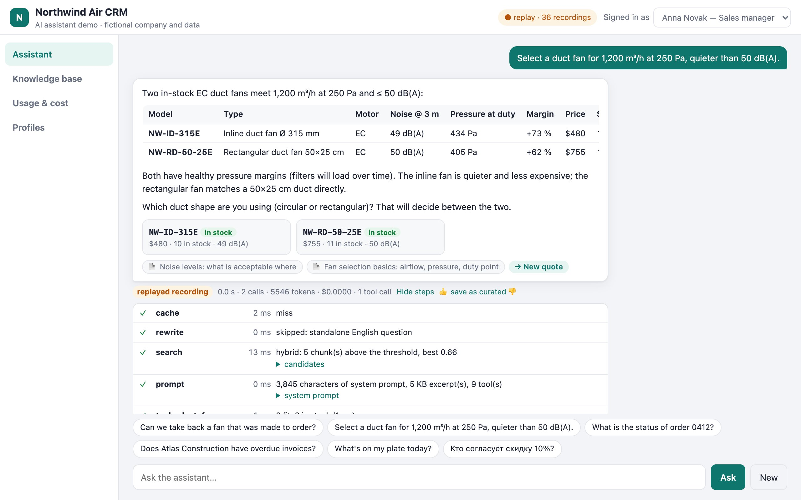
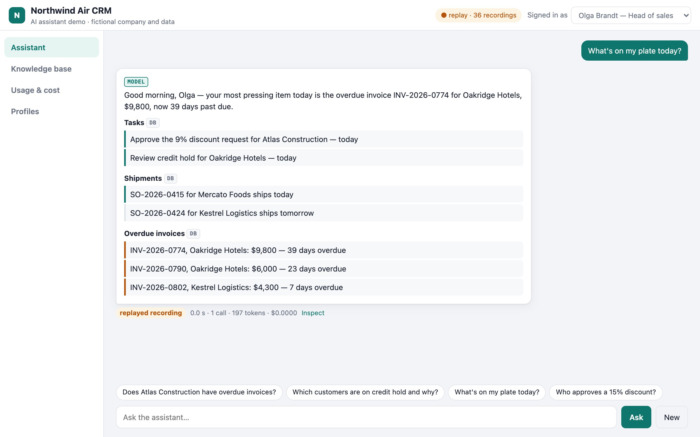
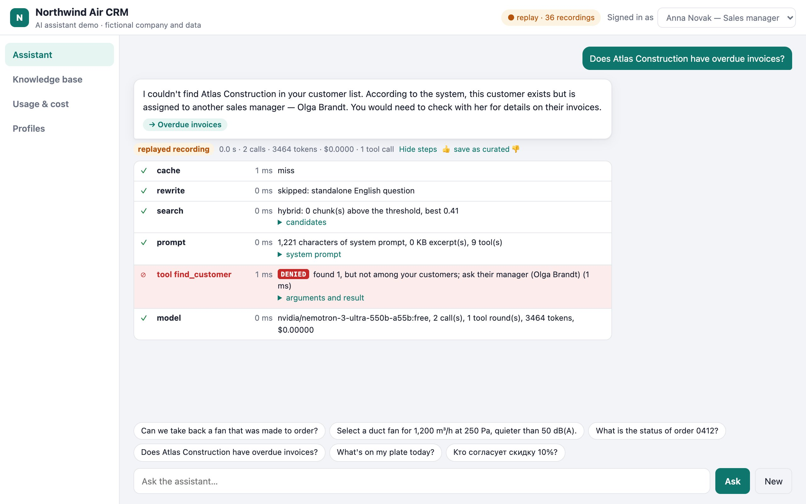
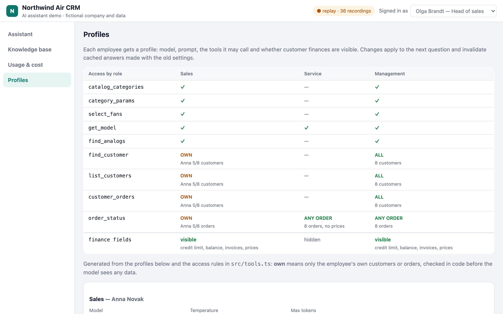
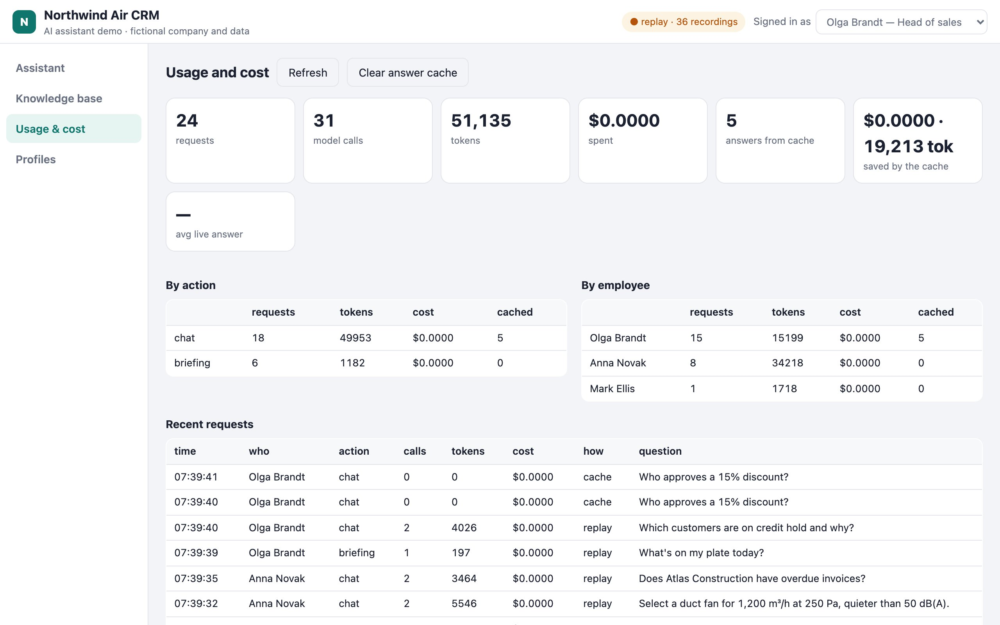
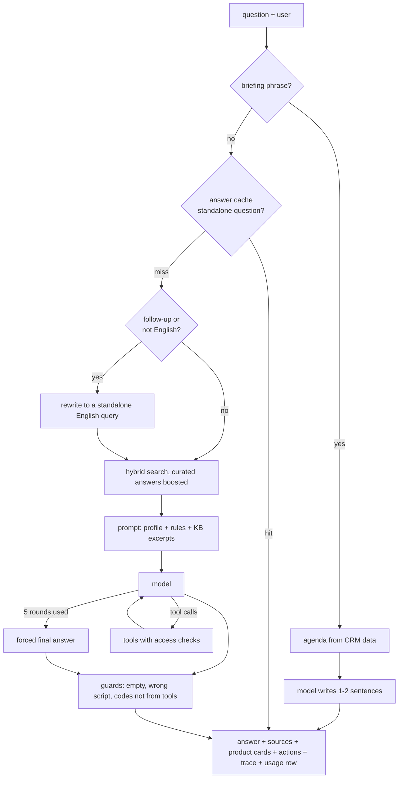

# CRM Assistant — an AI assistant inside a company CRM

An internal assistant for the employees of a (fictional) ventilation distributor, built the way I
built one for a real B2B CRM: it answers from the company knowledge base, looks up products,
customers and orders through tools, prepares a daily briefing, and every request is traced and
costed.



## What it shows

| Feature | How it works |
| --- | --- |
| **Knowledge-base answers** | Chunked wiki (≈700 characters, overlap), hybrid search (0.55 × cosine + 0.45 × BM25, lexical only without embeddings), curated answers boosted. Sources are added by code, never by the model. |
| **Tools instead of memory** | Model codes, prices, stock, ETAs, customers and orders only come from tool calls: duty-point fan selection on performance curves, model lookup, analogs, customer search, orders, overdue invoices. At most 5 rounds, then a forced final answer. |
| **Access control in code** | A sales manager sees only their own customers and orders; credit limits and prices are hidden from service engineers. A refusal shows as a red DENIED step in the inspector, and the Profiles page shows the tool × role access matrix generated from the same rules. The prompt is not the security boundary. |
| **Code check** | Every model code in an answer must have come from a tool result in that request; anything else is flagged as unverified. |
| **Daily briefing** | "What's on my plate?" builds the agenda from CRM data (overdue tasks, shipments, overdue invoices, claims); the model only writes one or two sentences on top, and is not called at all when there is nothing to report. Each part is tagged MODEL or DB. |
| **Answer cache** | The same standalone question is answered once per profile: the key is the question, the profile, its model, prompt and tools, so a sales answer is never served to service. Answers that used tools or name the asker are not cached. The usage page shows what the cache saved. |
| **Query rewriting** | Only when needed: follow-ups ("and how do I cancel it?") and non-English questions are turned into a standalone English search query. |
| **Output guards** | Empty answers, answers in another alphabet or a model writing the next turn itself get one stricter retry, then the usable part is kept. A malformed tool call falls back to an answer without tools. |
| **Profiles as data** | Per-role model, temperature, prompt, tools and finance visibility, edited on the Profiles page. |
| **Usage and cost** | One row per request: model calls, tokens, embedding tokens, cost from the provider's usage report, cache hits, latency. |
| **Incremental index** | Each document has a hash of title and text; a reindex re-chunks and re-embeds only what changed and drops what was deleted. A 👍 under an answer saves it as a curated answer and indexes it at once. |







## Run it

Node 20.12 or newer.

```bash
npm install
npm start            # http://127.0.0.1:4320
```

Without any key the demo replays recorded answers for the preset questions (one set per employee:
switch the user in the header). For live answers either add an OpenRouter key or run a local model:

```bash
cp .env.example .env     # OPENROUTER_API_KEY, a free chat model and a free embedding model
# or, fully local:
ollama serve &           # with qwen2.5:7b pulled
LLM_BASE_URL=http://localhost:11434/v1 LLM_MODEL=qwen2.5:7b EMBED_MODEL= npm start
```

```bash
npm test             # search, chunking, fan selection, access rules, briefing, guards
npm run record       # re-record the preset answers with the configured model
npm run screenshots  # regenerate docs/*.jpg (demo must be running)
npm run index        # rebuild the knowledge-base index (incremental)
npm run catalog      # regenerate the fictional catalogue
```

The bundled recordings were made with **`nvidia/nemotron-3-ultra-550b-a55b:free` on OpenRouter**, with
reasoning switched off (`LLM_REASONING_EFFORT=none`): the assistant makes short calls, such as an
80-token rewrite of a follow-up question, that a reasoning model would spend thinking. Search is
hybrid, with `nvidia/nemotron-3-embed-1b:free` embeddings. A local 7B model (`qwen2.5:7b`) shows the
same mechanics (tool calls, access checks, guards) but misreads tool results more often.



## How a request flows



## Data

Everything is fictional: Northwind Air, its employees, customers, orders and the catalogue of 46 fans
with performance curves (`npm run catalog` regenerates it). The knowledge base is 22 markdown
articles in `data/kb/` plus curated answers in `data/qa.json`. The demo date is 12 October 2026.

## Layout

| Path | Contents |
| --- | --- |
| `src/assistant.ts` | The request pipeline: briefing route, cache, rewrite, search, prompt, tool loop, guards |
| `src/kb.ts` | Chunking, incremental index, BM25, embeddings, hybrid search |
| `src/tools.ts` | Tool definitions, fan selection on curves, CRM lookups with access rules |
| `src/briefing.ts` | Deterministic agenda and the model's intro |
| `src/llm.ts` | OpenAI-compatible client: chat, tools, embeddings, paid-model guard, record/replay |
| `src/usage.ts` | Usage log and dashboard figures |
| `public/` | The UI: chat with inspector, knowledge base, usage, profiles |

## License

MIT, see [LICENSE](LICENSE). Northwind Air, its staff, customers, catalogue and knowledge base are
fictional and made up for the demo.
